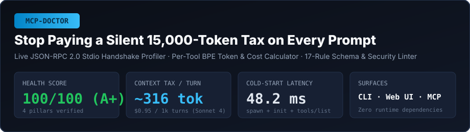

<p align="center">
  
</p>

<h1 align="center">mcp-doctor</h1>

<p align="center">
  <strong>Universal MCP server inspector, per-turn token profiler, JSON Schema linter, and cold-start latency auditor for AI coding agents.</strong>
</p>

<p align="center">
  <a href="https://github.com/NnopponS/mcp-doctor/actions"></a>
  <a href="https://github.com/NnopponS/mcp-doctor/blob/main/LICENSE"></a>
  = 18" />
  
</p>

---

## Why `mcp-doctor` Exists

Every Model Context Protocol (MCP) server registered in Claude Code, Cursor, Codex, Windsurf, or Gemini CLI injects its full `tools/list` payload into the model's context window on every turn. Four silent failure modes degrade agent reliability and inflate API spend:

1. **Hidden Context Tax.** A single unoptimized MCP server registering 30 tools with inline examples routinely consumes **8,000 to 25,000 input tokens per turn** before the user types a word. Over 1,000 turns on Claude Opus 4, a 15,000-token tool payload costs **\$225.00** in background context overhead alone.
2. **Broken JSON Schemas.** Missing root `type: "object"`, untyped properties, ghost entries in `required[]`, or 6-level nested schemas cause models to emit malformed tool calls or hallucinate parameter formats.
3. **Stdout Corruption & Cold-Start Stalls.** A stray `console.log()` on stdout breaks JSON-RPC 2.0 framing, and synchronous startup tasks delay IDE tool discovery.
4. **Unconstrained High-Risk Tools & Leaked Config Secrets.** Shell/SQL/write tools without boundary constraints (`enum`, `pattern`, `maxLength`) and plaintext API keys stored in `.mcp.json` or `claude_desktop_config.json` expose local workstations.

`mcp-doctor` measures all four in one command. It runs with **zero runtime dependencies** across CLI, a local Web Dashboard, CI pipelines, and its own MCP server mode.

---

## Quick Start

### Run from a checkout or install globally

```bash
git clone https://github.com/NnopponS/mcp-doctor.git
cd mcp-doctor
npm install
npm run build

# Run a side-by-side comparison of a bloated vs. optimized MCP server
node dist/cli.js demo
```

Or install directly from GitHub:

```bash
npm install -g github:NnopponS/mcp-doctor
mcp-doctor demo
```

---

## Core Workflows

### 1. Live Stdio Handshake & Latency Inspection (`check`)

Spawns any MCP server over stdio, performs a real JSON-RPC 2.0 `initialize` + `notifications/initialized` + `tools/list` + `resources/list` + `prompts/list` handshake, records millisecond timing for each phase, checks stdout hygiene, and audits every returned tool:

```bash
mcp-doctor check "node dist/cli.js mcp"
mcp-doctor check "npx -y @modelcontextprotocol/server-filesystem ." --ci
mcp-doctor check "python -m my_mcp_server" --markdown > report.md
```

Sample terminal output:

```text
============================================================================
MCP-DOCTOR REPORT | Server: mcp-doctor | Score: 100/100 (A+) | PASSED
============================================================================
Mode: live-stdio | Tools: 4 | Resources: 0 | Prompts: 0
Protocol: 2024-11-05 | Implementation: mcp-doctor@1.0.0
Handshake Latency: total=48.2ms (spawn=6.1ms, init=28.4ms, tools/list=13.7ms)
----------------------------------------------------------------------------
CONTEXT TOKEN FOOTPRINT: ~316 tokens/turn
Pillar Scores: Schema 40/40 | Tokens 30/30 | Latency 15/15 | Security 15/15

Top Tools by Per-Turn Token Tax:
  diagnose_mcp_server                [######------------]   103 tok ( 32.6%) | params=3 depth=1
  scan_mcp_config                    [#####-------------]    82 tok ( 25.9%) | params=2 depth=1
  audit_tool_schemas                 [####--------------]    69 tok ( 21.8%) | params=2 depth=1
  estimate_context_cost              [####--------------]    62 tok ( 19.6%) | params=1 depth=1

Estimated Input Token Cost (Context Tax Only):
  Claude Sonnet 4      $3.00/1M -> $0.0948 / 100 turns | $0.948 / 1,000 turns
  Claude Opus 4        $15.00/1M -> $0.4740 / 100 turns | $4.740 / 1,000 turns
  GPT-5                $2.50/1M -> $0.0790 / 100 turns | $0.790 / 1,000 turns
  Gemini 2.5 Pro       $1.25/1M -> $0.0395 / 100 turns | $0.395 / 1,000 turns
  DeepSeek V3          $0.27/1M -> $0.0085 / 100 turns | $0.085 / 1,000 turns
----------------------------------------------------------------------------
DIAGNOSTIC FINDINGS: 0 issues detected. Clean MCP contract.
============================================================================
```

### 2. Static Schema & Token Audit (`analyze`)

Audit a saved `tools/list` JSON file in CI without launching external binaries:

```bash
mcp-doctor analyze examples/bloated-tools.json
mcp-doctor analyze examples/optimized-tools.json --ci
```

### 3. Workstation Config & Secret Scanner (`scan-config`)

Scan `.mcp.json`, `.cursor/mcp.json`, `.vscode/mcp.json`, or `claude_desktop_config.json` for hardcoded API keys (`sk-...`, `ghp_...`, `AIza...`, `xoxb-...`, `AKIA...`), duplicate server commands, and optional live server health:

```bash
mcp-doctor scan-config
mcp-doctor scan-config ~/.cursor/mcp.json --live
```

### 4. Interactive Local Web Dashboard (`ui`)

Launch the local dark-mode Web Inspector to test live server commands, paste tool schemas, inspect token distribution bars, and copy GitHub-flavored Markdown reports:

```bash
mcp-doctor ui --port 4310
```

### 5. Self-Hosted MCP Server Mode (`mcp`)

Let your AI coding agent (Claude Code, Cursor, Codex, Antigravity) run `mcp-doctor` as an MCP tool server to diagnose and optimize other MCP servers automatically:

```json
{
  "mcpServers": {
    "mcp-doctor": {
      "command": "npx",
      "args": ["-y", "github:NnopponS/mcp-doctor", "mcp"]
    }
  }
}
```

Exposed MCP tools:
- `diagnose_mcp_server` — Spawn a target stdio MCP server and return a full `ServerDiagnosisReport`.
- `audit_tool_schemas` — Statically lint an array of MCP tool definitions and compute token weight.
- `estimate_context_cost` — Calculate per-turn, 100-turn, and 1,000-turn USD costs across frontier models.
- `scan_mcp_config` — Audit an MCP config file for plaintext secrets and duplicate commands.

---

## Diagnostic Rule Catalog (`MCP000`–`MCP017`)

All rules are defined declaratively in [`src/rules.ts`](src/rules.ts) and [`src/inspector.ts`](src/inspector.ts):

| Rule ID | Category | Severity | What It Checks |
| :--- | :--- | :---: | :--- |
| `MCP000` | `protocol` | **ERROR** | Stdio process failed to spawn, timed out, or returned a JSON-RPC error on `initialize`. |
| `MCP001` | `schema` | **ERROR** | Tool `inputSchema` is missing or `inputSchema.type !== "object"`. |
| `MCP002` | `schema` | **WARN** | Tool `description` is missing or shorter than 15 characters. |
| `MCP003` | `ergonomics` | **WARN** | Tool `description` exceeds 550 characters (inflates every prompt turn). |
| `MCP004` | `schema` | **WARN** | Property in `inputSchema.properties` lacks an explicit `type`, `enum`, or composition keyword. |
| `MCP005` | `ergonomics` | **INFO** | Property in `inputSchema.properties` lacks a `description`. |
| `MCP006` | `schema` | **ERROR** | `inputSchema.required` references a ghost parameter missing from `properties`. |
| `MCP007` | `schema` | **WARN** | Schema nesting depth exceeds 4 levels. |
| `MCP008` | `tokens` | **WARN** | Single tool consumes `> 400` tokens in `tools/list`. |
| `MCP009` | `tokens` | **ERROR** | Single tool consumes `> 1,000` tokens in `tools/list`. |
| `MCP010` | `tokens` | **WARN** | Total server `tools/list` payload exceeds `4,000` tokens per turn. |
| `MCP011` | `tokens` | **ERROR** | Total server `tools/list` payload exceeds `10,000` tokens per turn. |
| `MCP012` | `ergonomics` | **WARN** | Server registers `> 25` tools in a single flat namespace. |
| `MCP013` | `ergonomics` | **ERROR** | Tool name violates `^[a-zA-Z0-9_-]{1,64}$`. |
| `MCP014` | `security` | **WARN** | High-risk shell/SQL/write tool lacks boundary constraints (`enum`, `pattern`, `maxLength`) or safety annotations. |
| `MCP015` | `schema` | **INFO** | String parameter named `mode`, `status`, `format`, `action`, or `level` lacks an `enum` constraint. |
| `MCP016` | `protocol` | **WARN** | Cold-start `initialize` + `tools/list` handshake exceeded `2,000 ms`. |
| `MCP017` | `protocol` | **ERROR** | Server wrote non-JSON debug output to `stdout` during an active MCP session. |

---

## Programmatic TypeScript API

```typescript
import { analyzeMcpServer, inspectStdioServer, parseCommandString } from '@nnoppons/mcp-doctor';

const target = parseCommandString('node ./my-mcp-server.js', 'my-server');
const report = await inspectStdioServer(target, { timeoutMs: 5000 });

console.log(`Score: ${report.score}/100 (${report.grade}), Tokens/turn: ${report.totalTokens}`);
```

---

## License

MIT © [Worapon Sangsasri (NnopponS)](https://github.com/NnopponS)
